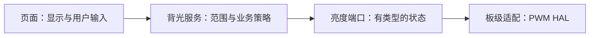

# 可选应用结构参考：页面、业务服务、硬件适配

仅适用于已有图形界面的应用。纯算法、驱动和控制环保持原架构，不引入 LVGL 或页面框架。小页面直接组合 View 与服务即可；当多个数据源、编辑态、生命周期与测试替身使页面复杂度足够时，再拆 Model/View/Presenter。

下面是原创背光设计，借鉴“职责可辨认”的观察，不复制 X-TRACK 实现。页面把用户意图交给服务，服务校验范围并执行产品策略，适配器负责 PWM/HAL 返回值映射；页面不操作寄存器。



```cpp
namespace display_ui {
enum class Status { kOk, kOutOfRange, kIoError };

class BrightnessPort
{
  public:
    /// @brief Apply a percentage. Task context only; caller retains this port.
    /// @param percent Value in [0, 100].
    /// @return kOk or kIoError; failure leaves the previous hardware level.
    virtual Status apply(unsigned percent) = 0;

  protected:
    /// @brief End a statically owned port lifetime; no resource release here.
    ~BrightnessPort() = default;
};

class BacklightService
{
  public:
    /// @brief Bind a port which must outlive the service. No hardware access.
    /// @param port Borrowed adapter; no ownership transfer.
    explicit BacklightService(BrightnessPort& port) : port_(port) {}

    /// @brief Request brightness. Task context; externally serialized, not ISR-safe.
    /// @param percent Requested percent; values above 100 are rejected.
    /// @return kOutOfRange without I/O, or the adapter result.
    Status setLevel(unsigned percent)
    {
        if (percent > 100) {
            return Status::kOutOfRange;
        }
        return port_.apply(percent);
    }

  private:
    BrightnessPort& port_;
};
} // namespace display_ui
```

组合根在板级初始化后构造静态适配器、服务与页面；引用依赖由组合根保证生命周期。适配器的 `apply` 实现调用项目已有 PWM API，明确错误时是否保留旧状态，不在示例中猜寄存器。页面调用 `setLevel` 并按返回状态更新提示，离开页面时注销订阅、停止动画、等待在途回调结束。跨线程请求用 `struct BrightnessRequest { unsigned percent; };` 等有类型消息，不传裸 `void*` 事件包。

复杂页面才需要：Model 保存快照/编辑态并向服务订阅；View 只负责控件与渲染；Presenter 处理导航、订阅与页面生命周期。避免让 Model 再实现一遍服务策略。页面测试用静态 Fake 端口验证“范围错误没有 I/O”和“硬件失败显示错误”；驱动测试独立覆盖 HAL 故障。这里不规定框架、资源堆分配或一套通用事件总线。

参考阅读的版本、路径、明文规则与样例观察的区别，见 [sources.md §本轮风格参考](../sources.md#本轮风格参考与可追溯依据)。X-TRACK 的裸资源所有权、无类型事件及控件实现均不采用。
